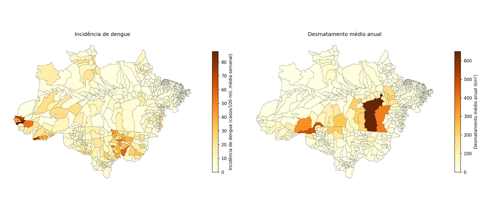
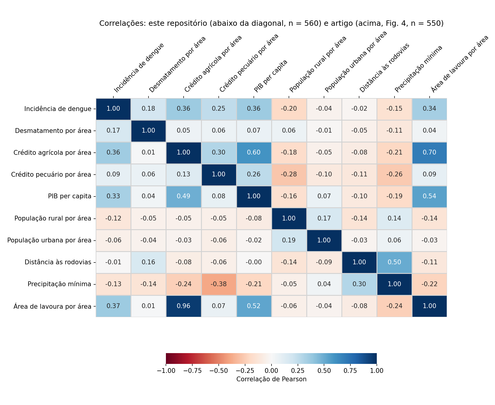
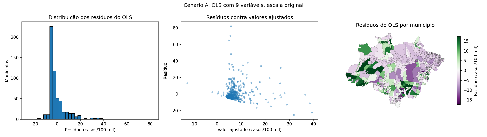
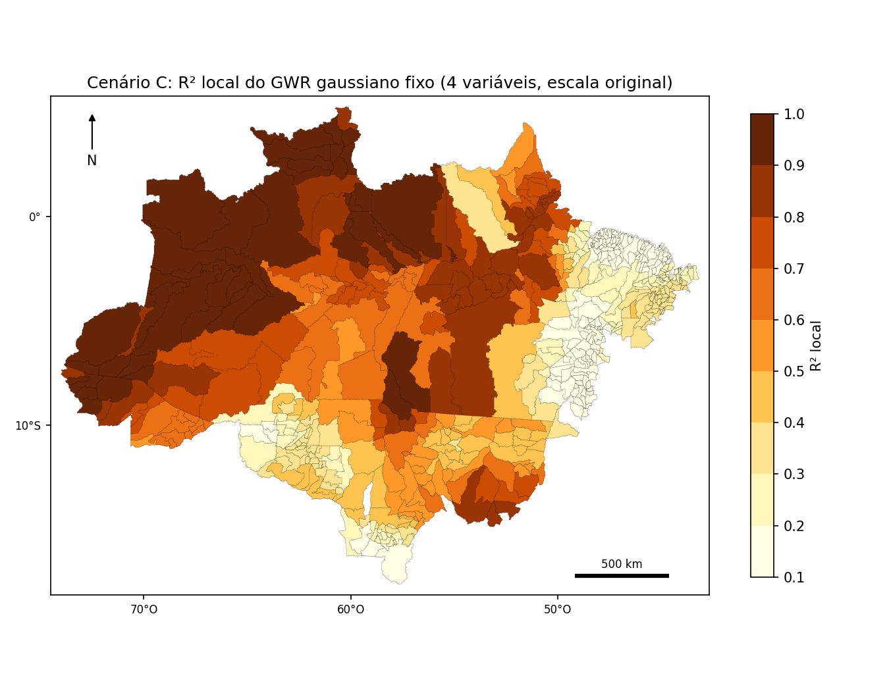
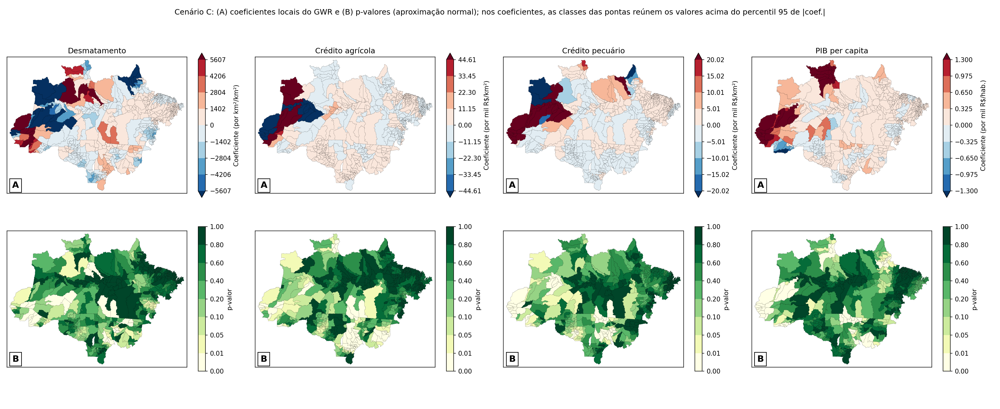

# Desmatamento e dengue na Amazônia brasileira

Reprodução, com dados públicos, do estudo de Silva et al. (2023) sobre a relação entre desmatamento e incidência de
dengue nos municípios do bioma Amazônia (2016–2021): ETL, análise exploratória, autocorrelação espacial (Moran),
OLS, GWR (regressão geograficamente ponderada) e modelos hierárquicos.

> **Status.** Os dados originais do artigo não estão disponíveis. Esta base foi reconstruída de fontes públicas e
> difere da original (ver [Diferenças em relação ao artigo](#diferenças-em-relação-ao-artigo)). Os resultados
> reproduzem o artigo **aproximadamente**, não exatamente.

## Artigo de referência

Silva et al. (2023). Deforestation impacts on dengue incidence in the Brazilian Amazon. *Environmental Monitoring and
Assessment*, 195:593. <https://doi.org/10.1007/s10661-023-11174-0>. Cópia:
`references/silva_2023_deforestation_dengue.pdf`.

## Resumo dos resultados

- A dengue tem forte dependência espacial: Moran global de 0,510 (p = 0,001; artigo 0,532).
- O OLS global explica pouco (R² = 0,186 com as 4 variáveis do artigo; artigo 0,20) e deixa os resíduos
  espacialmente correlacionados (Moran dos resíduos entre 0,37 e 0,38), o que justifica um modelo local.
- O GWR de núcleo gaussiano fixo, com banda escolhida por AICc, aproxima o artigo: ΔAICc contra o OLS de −437 (artigo
  −430) e R² ajustado de 0,741 (artigo 0,70), com banda de 103 km. O R² local é alto no oeste e no centro do bioma e baixo
  no leste (Maranhão) e no sul.
- Os coeficientes locais do desmatamento mudam de sinal ao longo do bioma: a relação não é estacionária, razão pela
  qual um único coeficiente global é enganoso.

## Dados

Todos os dados são agregados por município (média de 2016 a 2021) para os **560 municípios que intersectam o bioma**.

| Variável | Fonte | Observação |
|---|---|---|
| Dengue (`dengue_incidence`) | InfoDengue, via API do Mosqlimate | média das incidências semanais por 100 mil |
| Desmatamento | PRODES/INPE (Terrabrasilis) | cada polígono é atribuído ao município que contém seu centroide |
| Bioma e municípios | geobr/IBGE | malha simplificada de 2021 |
| PIB e população | SIDRA/IBGE (tabelas 5938, 6579, 202) | `gdp_capita` = PIB total (mil R$) / população estimada |
| Lavoura temporária | SIDRA 1612 | área plantada |
| Crédito rural | SICOR/Banco Central | agrícola e pecuário, soma de custeio e investimento |
| Precipitação mínima | bio14 (INPE/WorldClim) | média por município |
| Rodovias | IBGE 2014 | `dist_roads`: distância média, em km, das áreas desmatadas à rodovia mais próxima |

Variáveis "padronizadas" (`std_*`) são divididas pela área do município (km²). `dist_roads` é indefinida em
municípios sem desmatamento (os modelos usam a mediana).

## Métodos

Notação: $y_i$ é a incidência de dengue do município $i$, $x_{ik}$ são seus preditores (desmatamento, crédito, PIB etc.)
e $n = 560$ é o número de municípios.

### Dependência espacial: Moran e LISA

Perguntam se municípios vizinhos têm incidências parecidas. Os vizinhos são os municípios que dividem fronteira (critério
Queen), e a média dos vizinhos de $i$ é $\sum_j w_{ij}\, y_j$ (os pesos $w_{ij}$ somam 1 em cada município).

- **Moran global ($I$)**: um número só para o bioma. Perto de 1, vizinhos parecidos; perto de 0, sem padrão espacial.
  É a correlação entre a incidência de cada município e a média dos seus vizinhos, ambas medidas em desvios da média
  geral. O $p$ vem de 999 embaralhamentos aleatórios dos municípios (semente fixa).
- **LISA**: o mesmo cálculo município a município. Um município é **Alto-Alto** se sua incidência e a dos vizinhos estão
  acima da média e o resultado é significativo ($p<0{,}05$). **Baixo-Baixo**, **Baixo-Alto** e **Alto-Baixo** seguem a
  mesma lógica.

### Modelos de regressão

Todos tentam explicar $y_i$ pelos preditores. O que muda é o quanto cada modelo deixa a relação variar pelo território.

- **OLS (global).** Uma única equação para o bioma inteiro, em que cada preditor tem um coeficiente fixo:
  $y_i = \beta_0 + \sum_k \beta_k x_{ik} + \varepsilon_i$. O coeficiente $\beta_k$ diz quanto $y$ muda quando $x_k$ sobe
  uma unidade, mantidos os demais. O **VIF** mede se um preditor é redundante com os outros (valores altos, acima de 5
  a 10, indicam colinearidade). O **Moran dos resíduos** ($\varepsilon_i$) mostra se sobrou padrão espacial que o modelo
  não explicou.
- **OLS + efeito fixo de UF.** O mesmo OLS, mas cada estado ganha um "ponto de partida" próprio, $\gamma_{s(i)}$, somado
  à equação. Assim diferenças gerais entre estados (por exemplo, o estado inteiro ter mais dengue) não se misturam com
  o efeito dos preditores.
- **Misto por UF.** Também deixa cada estado ter o seu ponto de partida, mas o trata como sorteado de uma distribuição
  comum (efeito aleatório), em vez de estimá-lo isoladamente. Além disso, o efeito do desmatamento pode variar entre
  estados: $y_i = \beta_0 + \sum_k \beta_k x_{ik} + b_{0,s(i)} + b_{1,s(i)}\,d_i + \varepsilon_i$, em que $d_i$ é o
  desmatamento. O R² reportado compara a incidência real com a prevista já com esses ajustes por estado. O ajuste é por
  REML, então o AIC dele serve só como referência.
- **GWR (regressão geograficamente ponderada).** Em vez de uma equação para tudo, ajusta **uma equação para cada
  município**, dando mais peso aos municípios mais próximos dele:

  $$\hat{\boldsymbol\beta}(i) = (X^\top W_i X)^{-1} X^\top W_i\,\mathbf y$$

  É o OLS de sempre, só que a observação $j$ entra com peso $w_{ij}$, que cai com a distância $d_{ij}$ entre os
  municípios. Assim cada coeficiente vira um mapa. O peso depende do núcleo e da banda (o alcance da vizinhança):

  | Núcleo | Como o peso cai com a distância | Banda | Cenários |
  |---|---|---|---|
  | bisquare adaptativo | suave até zero em $h_i$: $w=(1-(d/h_i)^2)^2$; fora disso, 0 | cada município usa os mesmos $b$ vizinhos mais próximos ($h_i$ é a distância ao $b$-ésimo) | A, B |
  | gaussiano fixo (como no artigo) | curva em sino: $w=\exp(-\tfrac12 (d/h)^2)$ | mesmo raio $h$ (em metros) para todos | C, D |

  A banda é escolhida pelo **AICc**, um critério que equilibra ajuste e complexidade (quanto menor, melhor). Banda
  curta ajusta bem os dados, mas usa muitos parâmetros; banda longa se aproxima do OLS. O **R² ajustado** do GWR segue o
  GWmodel (usado pelo artigo) e desconta o número efetivo de parâmetros. O **ΔAICc** é o AICc do GWR menos o do OLS:
  valor negativo significa que o GWR compensa a complexidade extra, e ele não depende da escala de $y$.

### Variáveis em cada cenário

Os quatro cenários combinam dois conjuntos de preditores com dois tratamentos dos dados.

- **Conjuntos.** *9 vars*: `avg_deforestation`, `dist_roads`, `average_min_precipitation`, `gdp_capita` e as cinco
  `std_*` (população rural e urbana, crédito agrícola e pecuário, lavoura). *4 vars (artigo)*: `std_deforestation`,
  `std_agri_credit`, `std_live_credit`, `gdp_capita`.
- **Original (A e C).** Variáveis nas unidades de origem. Exceção: em A, o GWR recebe os preditores em z-score e o PIB
  per capita em $\ln(1+x)$.
- **Transformado (B e D).** Dois passos:
  1. **Log da resposta**, $y^*=\ln(1+y)$: a incidência tem muitos zeros e poucos valores muito altos, e o log reduz
     essa assimetria.
  2. **Z-score dos preditores**, $x^*=(x-\bar x)/s$: coloca todos na mesma escala (média 0, desvio 1), de modo que os
     coeficientes passam a ser "por desvio-padrão" e o GWR fica numericamente estável.

  Em B os preditores recebem antes $\ln(1+\max(x,0))$. Em D isso vale só para o OLS + efeito fixo de UF e o misto; o OLS
  e o GWR de D usam apenas o z-score. Em B e D soma-se um ruído minúsculo ($10^{-10}$) aos preditores para evitar
  colinearidade exata.

O z-score não muda o ajuste do OLS, só a leitura dos coeficientes. O log de $y$ muda a escala do AIC, que por isso só se
compara entre modelos com o mesmo $y$ (original ou log).

## Resultados

Tabela completa em `data/results/10_final_model_comparison.csv`. Cada célula traz R² (AIC).

| Cenário | Vars | OLS | OLS + efeito fixo de UF | Misto por UF | GWR |
|---|---:|---|---|---|---|
| A. 9 vars, original | 9 | 0,179 (4145,9) | 0,417 (3970,5) | 0,424 (4070,0) | 0,506 (3963,7) |
| B. 9 vars, log1p + z-score | 9 | 0,466 (1340,5) | 0,569 (1236,6) | 0,581 (1297,0) | 0,656 (1207,9) |
| C. 4 vars (artigo), original | 4 | 0,186 (4130,8) | 0,413 (3963,8) | 0,436 (4013,3) | 0,839 (3549,0) |
| D. 4 vars (artigo), y log1p + X z-score | 4 | 0,266 (1508,5) | 0,541 (1262,0) | 0,551 (1306,2) | 0,743 (1132,5) |

GWR adaptativo (bisquare) em A e B; GWR fixo (gaussiano) em C e D. AIC só é comparável dentro do mesmo cenário (a escala
de y muda entre original e log). O R² do GWR é otimista, porque o modelo usa muitos parâmetros efetivos; compare modelos
pelo AICc e pelo R² ajustado.

### Comparação com o artigo

| Item | Artigo | Este repositório |
|---|---|---|
| Municípios | 550, totalmente dentro do bioma | 560, que intersectam o bioma |
| Resposta | taxa média por 100 mil (DATASUS/Sinan) | média das incidências semanais (InfoDengue) |
| Moran global (dengue) | 0,532 | 0,510 |
| Moran dos resíduos do OLS | 0,359 | 0,366 a 0,380, conforme a resposta |
| OLS, 4 variáveis, escala bruta: R² | 0,20 | 0,186 (ajustado 0,180) |
| VIF das 4 variáveis | 1,006 / 1,621 / 1,111 / 1,583 | 1,01 / 1,33 / 1,02 / 1,32 |
| GWR: ΔAICc contra o OLS | −430 (AIC 7949 → 7519) | −437 |
| GWR: R² ajustado (GWmodel) | 0,70 | 0,741 (R² global 0,839; banda 103 km) |
| Clusters Alto-Alto (LISA) | 2 regiões ao sul, 69 municípios | MT e AC, 52 municípios |

O ΔAICc não depende da escala de y, por isso é a comparação mais robusta. O artigo não informa o núcleo nem o critério
de banda; o gaussiano fixo por AICc foi o que melhor reproduziu seus números (o bisquare adaptativo, testado nas mesmas 4
variáveis brutas, dá R² ajustado de apenas 0,44 pela fórmula do GWmodel).

### Diferenças em relação ao artigo

- **Dados.** Fontes e definições diferem (InfoDengue em vez de Sinan; crédito do SICOR). Na matriz de correlação da
  Fig. 4 do artigo, o erro absoluto médio é 0,07 nas 45 correlações de Pearson. Batem: dengue~crédito agrícola (0,36),
  dengue~PIB (0,36), dengue~desmatamento (0,17 vs 0,18), dengue~lavoura (0,37 vs 0,34). Não batem: crédito pecuário
  (dengue 0,09 vs 0,25), população rural~crédito pecuário (−0,05 vs −0,28), `dist_roads` (nenhum período testado
  reproduz; o artigo usa 2019–2021), lavoura~crédito agrícola (0,96 vs 0,70). Com crédito agrícola **per capita** a
  correlação PIB~crédito agrícola fica em 0,60 e os VIFs em 1,57/1,60, iguais aos do artigo (1,62/1,58); isso sugere que
  a padronização "por área" descrita no artigo pode não ser a usada de fato. É uma hipótese, não verificada.
- **560 vs 550 municípios.** Os 10 a mais são os de menor fração dentro do bioma (todos com menos de 2,2%). Retirá-los
  não muda os resultados: Moran 0,510 nos dois casos, OLS R² 0,186 vs 0,183, R² ajustado do GWR 0,741 vs 0,746 e
  ΔAICc −437 vs −434. Foram mantidos os 560, porque o critério de corte do artigo não é reprodutível.
- **Escala dos coeficientes.** A resposta aqui é a média semanal, então os coeficientes locais (Tabela 3 do artigo)
  saem cerca de 52 vezes menores que os do artigo (taxa anual). Com a soma anual, o intercepto tem mediana 80 (artigo
  82) e o PIB per capita 1,50 (artigo 1,71). O desmatamento tem a mesma ordem de grandeza, mas sinal e quartis
  diferentes (mediana −1,8 mil vs 4,1 mil). As unidades do crédito no artigo não são informadas.
- **Clusters LISA.** Há menos municípios Alto-Alto (52 vs 69) e a localização só coincide em parte (MT e AC); o
  Coldspot concentra-se em MA e PA (131 dos 140 municípios Baixo-Baixo).

## Figuras

Os mapas e a matriz de correlação seguem o estilo das figuras do artigo (moldura, classes discretas de cor, painéis A/B).
Aqui estão as figuras principais, na ordem da análise; as demais ficam em `figures/` (lista ao final).

**1. Dengue e desmatamento por município.** A escala de cores é em raiz quadrada, para distinguir os valores baixos.



**2. Correlações: este repositório (abaixo da diagonal) e artigo (acima, Fig. 4).** Os valores do artigo foram lidos da
figura; alguns são tênues no PDF, então pode haver diferença de 0,01 a 0,02.



**3. Dependência espacial: clusters LISA** (cores e classes da Fig. 3 do artigo) e diagrama de Moran. Hotspots em MT e
AC; coldspots em MA e PA.


**4. Resíduos do OLS (cenário A).** O mapa mostra agrupamentos de resíduos positivos e negativos, o padrão espacial que
o Moran dos resíduos quantifica e que justifica o GWR.



**5. R² local do GWR adaptativo nos cenários A (original) e B (log1p + z-score), na mesma escala de cores.**


**6. Reprodução do artigo (cenário C): R² local** (Fig. 5 do artigo).



**7. Reprodução do artigo (cenário C): coeficientes locais (A) e p-valores (B)**, no formato das Figs. 6 a 9. Os p-valores
usam a aproximação normal dos t locais, sem correção para múltiplas comparações; os coeficientes dos créditos estão em
mil R$/km².



Também em `figures/`: distribuições com mediana (01), boxplots em escala log (02), matriz de correlação só deste
repositório (03), dispersões com tendência LOWESS e ρ de Spearman (04), mapas dos preditores em escala de potência (06),
R² local do cenário A (09) e correlação após a transformação do cenário B (10). Todas as figuras têm título, eixos e
unidades em português.

## Como executar

```bash
./run_pipeline.sh
```

ou por etapas:

```bash
uv run python etl/01_download_data.py        # exige MOSQLIMATE_API_KEY (em .env) para o InfoDengue
uv run python etl/02_preprocess_data.py
uv run python eda/03_eda_pre_modeling.py
uv run python models/run_models.py
```

Tempo total aproximado de 40 s, pico de 1,7 GB de RAM, com os dados brutos já baixados.

## Estrutura

```
etl/01_download_data.py      download das fontes brutas em data/raw/
etl/02_preprocess_data.py    base municipal em data/processed/ (CSV e GPKG)
eda/03_eda_pre_modeling.py   estatísticas e figuras 01 a 06 e 14
models/run_models.py         modelos, métricas em data/results/ e figuras 07 a 13
README_original.md           README anterior a esta revisão, para comparação
```
