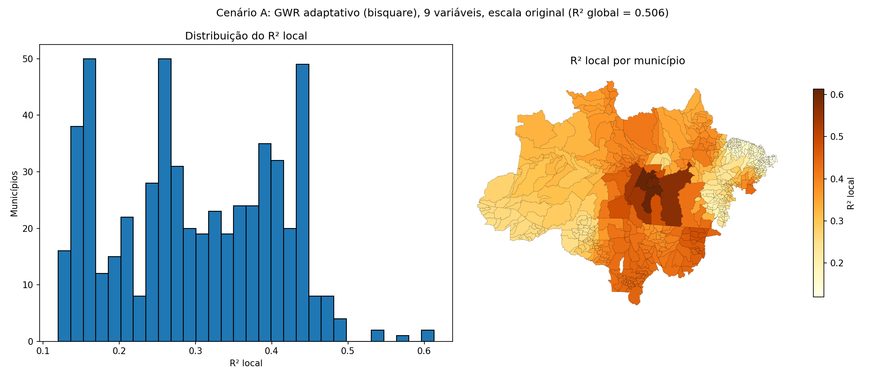

# Deforestation and Dengue Modeling in the Brazilian Amazon

Pipeline de reprodução do estudo sobre a relação entre desmatamento e incidência de dengue em municípios da Amazônia brasileira (2016-2021), com foco em rastreabilidade metodológica (ETL -> EDA -> Moran -> OLS -> GWR).

## Artigo de referência

- Silva et al. (2023). Deforestation impacts on dengue incidence in the Brazilian Amazon. Environmental Monitoring and Assessment, 195:593.
- DOI: https://doi.org/10.1007/s10661-023-11174-0
- Cópia local (acesso pago, fora do git): `references/silva_2023_deforestation_dengue.pdf`

## Objetivo do projeto

Este repositório implementa um fluxo completo de:

1. Download dos dados brutos geoespaciais, epidemiológicos e socioeconômicos.
2. Pré-processamento e integração municipal em base analítica única.
3. EDA pré-modelagem com estatísticas, correlações e mapas.
4. Modelagem espacial com Moran, OLS e GWR.
5. Comparação entre cenários baseline, transformados e reprodução do paper.

## Diagnóstico dos scripts

### ETL

- etl/01_download_data.py
  - Faz download das fontes brutas (IBGE/geobr, SIDRA, InfoDengue, SICOR, PRODES, WorldClim e malha rodoviária).
  - Salva os arquivos em data/raw.

- etl/02_preprocess_data.py
  - Agrega dados por município para 2016-2021.
  - Cria variáveis padronizadas por área municipal (km²).
  - Exporta:
    - data/processed/deforestation_dengue_data.csv
    - data/processed/deforestation_dengue_geo.gpkg

### EDA

- eda/03_eda_pre_modeling.py
  - Estatísticas descritivas, zeros/NA e skewness.
  - Correlação, dispersões e mapas exploratórios.
  - Exporta:
    - data/processed/03_eda_statistics.csv
    - figuras 01 a 06 em figures/

### Modelagem

- models/run_models.py: Moran/LISA, OLS (VIF), GWR (bisquare, AICc), cenário transformado, reprodução do paper (4 variáveis), modelos hierárquicos e resumo final das métricas.

## Dados utilizados

- Dengue (InfoDengue/DATASUS): data/raw/dengue.csv
- Desmatamento (PRODES/INPE): data/raw/prodes_biome_amazonia.gpkg
- Bioma e municípios (geobr/IBGE): data/raw/amazon.gpkg e data/raw/municipality.gpkg
- PIB per capita (SIDRA tabela 5938): data/raw/pib.csv
- População urbana/rural (SIDRA tabela 202): data/raw/populacao_situacao.csv
- População estimada (SIDRA tabela 6579): data/raw/populacao_estimativa.csv
- Lavoura temporária (SIDRA tabela 1612): data/raw/lavoura_temporaria.csv
- Crédito rural (SICOR/BCB): data/raw/sicor_contratos_*.csv
- Precipitação mínima (WorldClim bio14): data/raw/precipitation_min_amzl.asc
- Rodovias (IBGE 2014): data/raw/2014/rodovia_2014.shp

## Variáveis analisadas

### Resposta

- `dengue_incidence`: incidência média de dengue por 100 mil habitantes.

### Preditores do baseline (9)

- `avg_deforestation`: média anual de área desmatada (km²). Cada polígono do PRODES é atribuído ao município do seu centroide.
- `dist_roads`: distância média entre áreas desmatadas e rodovias (km). Ausente (imputada pela mediana nos modelos) em municípios sem desmatamento.
- `average_min_precipitation`: precipitação média mínima no mês mais seco.
- `gdp_capita`: PIB per capita (R$ mil por habitante) = PIB total (SIDRA 5938, mil R$) / população estimada.
- `std_rural_pop`: população rural padronizada por km².
- `std_urban_pop`: população urbana padronizada por km².
- `std_agri_credit`: crédito agrícola padronizado por km².
- `std_live_credit`: crédito pecuário padronizado por km².
- `std_crop_area`: área de lavoura temporária padronizada por km².

### Preditores da reprodução do paper (4), Tabela 1 do artigo

- `std_deforestation`: desmatamento médio anual (km²) padronizado pela área do município.
- `std_agri_credit` e `std_live_credit`: crédito rural agrícola e pecuário por km².
- `gdp_capita`: PIB per capita (sem log, como na Tabela 2 do artigo).

## Comparação com o artigo (Silva et al., 2023)

| Item | Artigo | Este repositório |
|---|---|---|
| Municípios | 550 totalmente dentro do bioma | 560 que intersectam o bioma (geobr 2021) |
| Resposta | taxa média de dengue por 100 mil (DATASUS/Sinan) | média das incidências semanais (InfoDengue) |
| Moran global (dengue) | 0,532 | 0,510 |
| Moran dos resíduos do OLS | 0,359 | 0,366 (resposta anual) / 0,379 |
| OLS (4 variáveis, escala bruta) R² | 0,20 | 0,186 (ajustado 0,180) |
| VIF das 4 variáveis | 1,006 / 1,621 / 1,111 / 1,583 | 1,01 / 1,33 / 1,02 / 1,32 |
| GWR R² (ajustado, segundo o resumo) | 0,70 (AIC 7519) | 0,513 (ajustado 0,458) com bisquare adaptativo e AICc |
| Clusters Alto-Alto | dois, no sul do bioma (69 municípios) | MT e AC (50 municípios) |

O OLS e a autocorrelação reproduzem bem. O GWR não reproduz o R² de 0,70: o artigo usou R (GWmodel) sem
informar kernel nem critério de banda. Em testes com a especificação do artigo, o núcleo gaussiano fixo dá
R² ajustado de 0,58 (CV) a 0,77 (AICc), o bisquare adaptativo 0,46 a 0,49, ou seja, o resultado depende
da escolha da banda. Os AIC não são comparáveis porque a escala da resposta difere.

## Métricas principais (execução atual)

- Moran global (dengue): I = 0,510, p = 0,001 (`data/results/moran_metrics.json`)
- OLS baseline (9 variáveis): R² = 0,179, AIC = 4145,9
- GWR baseline: R² = 0,506, AIC = 3963,7

Comparação consolidada (`data/results/10_final_model_comparison.csv`):

| Iteração | Variáveis | Transformações | OLS R² | OLS AIC | GWR R² | GWR AIC |
|---|---:|---|---:|---:|---:|---:|
| 1. Baseline | 9 | Nenhuma (Raw) | 0,179 | 4145,9 | 0,506 | 3963,7 |
| 2. Transformado Otimizado | 9 | Log1p(y) e Log1p/Norm(X) | 0,466 | 1340,5 | 0,656 | 1207,9 |
| 3. Reprodução Paper (Original) | 4 | Nenhuma (Escala Raw) | 0,186 | 4130,8 | 0,513 | 3948,6 |
| 4. Reprodução Paper (Transf) | 4 | Log1p(y) e Z-Score(X) | 0,266 | 1508,5 | 0,612 | 1257,2 |

## Figuras relevantes

### 1) Matriz de correlação dos preditores e resposta


### 2) Mapa exploratório de dengue e desmatamento


### 3) Clusters LISA (autocorrelação local)


### 4) R² local do GWR (baseline)



### 5) Comparação lado a lado do R² local do GWR completo

Sem transformações vs com transformações, com R² global explícito no título de cada painel.


## Como executar

Execução completa:

```bash
chmod +x run_pipeline.sh
./run_pipeline.sh
```

Execução por etapas:

```bash
uv run python3 etl/01_download_data.py
uv run python3 etl/02_preprocess_data.py
uv run python3 eda/03_eda_pre_modeling.py
uv run python3 models/run_models.py
```
