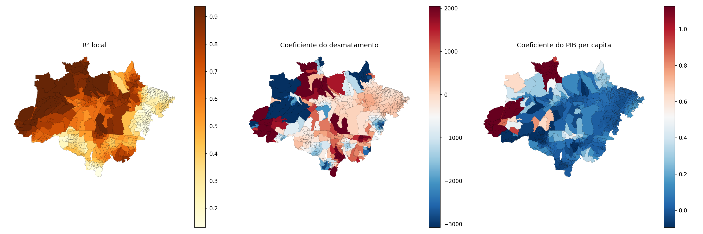

# Desmatamento e dengue na Amazônia brasileira

Reprodução, com dados públicos, do estudo de Silva et al. (2023) sobre a relação entre desmatamento e incidência de
dengue nos municípios do bioma Amazônia (2016–2021): ETL, análise exploratória, autocorrelação espacial (Moran),
OLS, GWR (regressão geograficamente ponderada) e modelos hierárquicos.

> **Status.** Os dados originais do artigo não estão disponíveis. Esta base foi reconstruída de fontes públicas e
> difere da original (ver [Diferenças em relação ao artigo](#diferenças-em-relação-ao-artigo)). Os resultados
> reproduzem o artigo **aproximadamente**, não exatamente.

## Artigo de referência

Silva et al. (2023). Deforestation impacts on dengue incidence in the Brazilian Amazon. *Environmental Monitoring and
Assessment*, 195:593. <https://doi.org/10.1007/s10661-023-11174-0>. Cópia local (acesso pago, fora do git):
`references/silva_2023_deforestation_dengue.pdf`.

## Resumo dos resultados

- A dengue tem forte dependência espacial: Moran global de 0,510 (p = 0,001; artigo 0,532).
- O OLS global explica pouco (R² = 0,186 com as 4 variáveis do artigo; artigo 0,20) e deixa os resíduos
  espacialmente correlacionados (Moran dos resíduos entre 0,37 e 0,38), o que justifica um modelo local.
- O GWR de núcleo gaussiano fixo, com banda escolhida por AICc, aproxima o artigo: ΔAICc contra o OLS de −437 (artigo
  −430) e R² ajustado de 0,741 (artigo 0,70), com banda de 103 km. O R² local é alto no oeste e no centro do bioma e baixo
  no leste (Maranhão) e no sul.
- Os coeficientes locais do desmatamento mudam de sinal ao longo do bioma: a relação não é estacionária, razão pela
  qual um único coeficiente global é enganoso.

## Dados

Todos os dados são agregados por município (média de 2016 a 2021) para os **560 municípios que intersectam o bioma**.

| Variável | Fonte | Observação |
|---|---|---|
| Dengue (`dengue_incidence`) | InfoDengue, via API do Mosqlimate | média das incidências semanais por 100 mil |
| Desmatamento | PRODES/INPE (Terrabrasilis) | cada polígono é atribuído ao município que contém seu centroide |
| Bioma e municípios | geobr/IBGE | malha simplificada de 2021 |
| PIB e população | SIDRA/IBGE (tabelas 5938, 6579, 202) | `gdp_capita` = PIB total (mil R$) / população estimada |
| Lavoura temporária | SIDRA 1612 | área plantada |
| Crédito rural | SICOR/Banco Central | agrícola e pecuário, soma de custeio e investimento |
| Precipitação mínima | bio14 (INPE/WorldClim) | média por município |
| Rodovias | IBGE 2014 | `dist_roads`: distância média, em km, das áreas desmatadas à rodovia mais próxima |

Variáveis "padronizadas" (`std_*`) são divididas pela área do município (km²). `dist_roads` é indefinida em
municípios sem desmatamento (os modelos usam a mediana).

## Métodos

1. **Moran global e LISA** (vizinhança Queen, pesos normalizados por linha) para a incidência de dengue.
2. **OLS** com diagnóstico de multicolinearidade (VIF) e Moran dos resíduos.
3. **GWR** gaussiano com intercepto e coeficientes locais:
   - baseline (9 variáveis): bisquare adaptativo, banda por AICc;
   - reprodução do artigo (4 variáveis, Tabela 1): núcleo gaussiano **fixo**, banda por AICc.
4. **Cenários**: bruto, e transformado (log1p em y e nos preditores, z-score).
5. **Hierárquico**: modelo misto por estado (efeito aleatório no desmatamento) e OLS com efeitos fixos de estado.

O R² ajustado do GWR segue o GWmodel (usado pelo artigo): parâmetros efetivos = 2·tr(S) − tr(SᵀS).

Os preditores do artigo são desmatamento médio anual por área, crédito agrícola e pecuário por área e PIB per capita
(sem log). O baseline acrescenta distância a rodovias, precipitação mínima, população urbana e rural e área de lavoura.

## Resultados

Tabela completa em `data/results/10_final_model_comparison.csv`. Cada célula traz R² (AIC).

| Cenário | Vars | OLS | Hier. (município) | Hier. (estado) | GWR |
|---|---:|---|---|---|---|
| 1. Baseline, bruto | 9 | 0,179 (4145,9) | 0,417 (3970,5) | 0,424 (4070,0) | 0,506 (3963,7) |
| 2. Transformado | 9 | 0,466 (1340,5) | 0,569 (1236,6) | 0,581 (1297,0) | 0,656 (1207,9) |
| 3. Artigo, bruto, GWR fixo | 4 | 0,186 (4130,8) | 0,413 (3963,8) | 0,436 (4013,3) | 0,839 (3549,0) |
| 4. Artigo, transformado, GWR fixo | 4 | 0,266 (1508,5) | 0,541 (1262,0) | 0,551 (1306,2) | 0,743 (1132,5) |

AIC só é comparável dentro do mesmo cenário (a escala de y muda entre bruto e transformado). O R² do GWR é
otimista, porque o modelo usa muitos parâmetros efetivos; compare modelos pelo AICc e pelo R² ajustado.

### Comparação com o artigo

| Item | Artigo | Este repositório |
|---|---|---|
| Municípios | 550, totalmente dentro do bioma | 560, que intersectam o bioma |
| Resposta | taxa média por 100 mil (DATASUS/Sinan) | média das incidências semanais (InfoDengue) |
| Moran global (dengue) | 0,532 | 0,510 |
| Moran dos resíduos do OLS | 0,359 | 0,366 a 0,380, conforme a resposta |
| OLS, 4 variáveis, escala bruta: R² | 0,20 | 0,186 (ajustado 0,180) |
| VIF das 4 variáveis | 1,006 / 1,621 / 1,111 / 1,583 | 1,01 / 1,33 / 1,02 / 1,32 |
| GWR: ΔAICc contra o OLS | −430 (AIC 7949 → 7519) | −437 |
| GWR: R² ajustado (GWmodel) | 0,70 | 0,741 (R² global 0,839; banda 103 km) |
| Clusters Alto-Alto (LISA) | 2 regiões ao sul, 69 municípios | MT e AC, 52 municípios |

O ΔAICc não depende da escala de y, por isso é a comparação mais robusta. O artigo não informa o núcleo nem o critério
de banda; o gaussiano fixo por AICc foi o que melhor reproduziu seus números (o bisquare adaptativo do baseline dá R²
ajustado de apenas 0,46).

### Diferenças em relação ao artigo

- **Dados.** Fontes e definições diferem (InfoDengue em vez de Sinan; crédito do SICOR). Na matriz de correlação da
  Fig. 4 do artigo, o erro absoluto médio é 0,07 nas 45 correlações de Pearson. Batem: dengue~crédito agrícola (0,36),
  dengue~PIB (0,36), dengue~desmatamento (0,17 vs 0,18), dengue~lavoura (0,37 vs 0,34). Não batem: crédito pecuário
  (dengue 0,09 vs 0,25), população rural~crédito pecuário (−0,05 vs −0,28), `dist_roads` (nenhum período testado
  reproduz; o artigo usa 2019–2021), lavoura~crédito agrícola (0,96 vs 0,70). Com crédito agrícola **per capita** a
  correlação PIB~crédito agrícola fica em 0,60 e os VIFs em 1,57/1,60, iguais aos do artigo (1,62/1,58); isso sugere que
  a padronização "por área" descrita no artigo pode não ser a usada de fato. É uma hipótese, não verificada.
- **560 vs 550 municípios.** Os 10 a mais são os de menor fração dentro do bioma (todos com menos de 2,2%). Retirá-los
  não muda os resultados: Moran 0,510 nos dois casos, OLS R² 0,186 vs 0,183, R² ajustado do GWR 0,741 vs 0,746 e
  ΔAICc −437 vs −434. Foram mantidos os 560, porque o critério de corte do artigo não é reprodutível.
- **Escala dos coeficientes.** A resposta aqui é a média semanal, então os coeficientes locais (Tabela 3 do artigo)
  saem cerca de 52 vezes menores que os do artigo (taxa anual). Com a soma anual, o intercepto tem mediana 80 (artigo
  82) e o PIB per capita 1,50 (artigo 1,71). O desmatamento tem a mesma ordem de grandeza, mas sinal e quartis
  diferentes (mediana −1,8 mil vs 4,1 mil). As unidades do crédito no artigo não são informadas.
- **Clusters LISA.** Há menos municípios Alto-Alto (52 vs 69) e a localização só coincide em parte (MT e AC); o
  Coldspot concentra-se em MA e PA (131 dos 140 municípios Baixo-Baixo).

## Figuras

**Clusters LISA da incidência de dengue.** Hotspots em MT e AC; coldspots em MA e PA.


**R² local do GWR do artigo e coeficientes locais** (escalas cortadas nos percentis 5 e 95). O coeficiente do
desmatamento muda de sinal no espaço.



**R² local do GWR baseline, sem e com transformações.**


Também em `figures/`: distribuições e boxplots (01, 02), matriz de correlação (03, 10), dispersões (04), mapas
exploratórios (05, 06), resíduos do OLS (08) e R² local do baseline (09).

## Limitações

- Estudo ecológico, de associação: os resultados não permitem inferência causal nem individual.
- A base é reconstruída; as diferenças de definição de dengue e de crédito não podem ser resolvidas sem os dados originais.
- A incidência de dengue por município é uma média de seis anos, e os coeficientes de GWR são exploratórios (sem
  correção para múltiplas comparações) e sensíveis à banda.
- O R² do GWR contém sobreajuste por construção; só o AICc e o R² ajustado penalizam a flexibilidade.
- O artigo não informa núcleo e banda, e o gaussiano fixo é uma escolha empírica, não confirmada pelos autores.

## Como executar

```bash
./run_pipeline.sh
```

ou por etapas:

```bash
uv run python etl/01_download_data.py        # exige MOSQLIMATE_API_KEY (em .env) para o InfoDengue
uv run python etl/02_preprocess_data.py
uv run python eda/03_eda_pre_modeling.py
uv run python models/run_models.py
```

Tempo total aproximado de 40 s, pico de 1,7 GB de RAM, com os dados brutos já baixados (ver `PERF.md`).

## Estrutura

```
etl/01_download_data.py      download das fontes brutas em data/raw/
etl/02_preprocess_data.py    base municipal em data/processed/ (CSV e GPKG)
eda/03_eda_pre_modeling.py   estatísticas e figuras 01 a 06
models/run_models.py         modelos, métricas em data/results/ e figuras 07 a 12
PERF.md                      registro de otimizações
README_original.md           README anterior a esta revisão, para comparação
```
